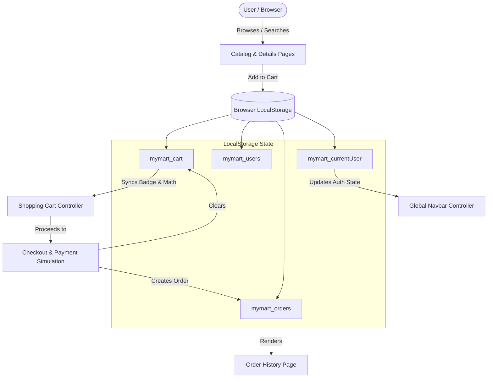

# 🛍️ MYMART - Premium Fashion & Beauty E-Commerce Platform

[](https://github.com/satyamp18/Mypro)
[](https://developer.mozilla.org/en-US/docs/Web/HTML)
[](https://developer.mozilla.org/en-US/docs/Web/CSS)
[](https://developer.mozilla.org/en-US/docs/Web/JavaScript)
[](LICENSE)

> *"Everything You Need, All in One Place."*  
> **MYMART** is a modern, responsive Indian e-commerce web platform specializing in curated Fashion and Beauty products. Engineered using **pure Vanilla JavaScript (ES6), Semantic HTML5, and Modern CSS3** with **Browser LocalStorage API** state persistence—requiring zero external libraries, zero build steps, and zero server dependencies.

---

## 📑 Table of Contents

- [🌟 Live Demo & Deployment](#-live-demo--deployment)
- [✨ Key Features](#-key-features)
- [🏗️ System Architecture & Data Flow](#️-system-architecture--data-flow)
- [📁 Project Directory Structure](#-project-directory-structure)
- [💾 LocalStorage Data Schema](#-localstorage-data-schema)
- [🚀 Quick Start & Local Setup](#-quick-start--local-setup)
- [🌐 Production Deployment Guide](#-production-deployment-guide)
  - [Deploy to GitHub Pages](#1-deploy-to-github-pages)
  - [Deploy to Vercel](#2-deploy-to-vercel)
  - [Deploy to Netlify](#3-deploy-to-netlify)
- [💡 Technical Highlights](#-technical-highlights)
- [👨‍💻 Author & License](#-author--license)

---

## 🌟 Live Demo & Deployment

This repository is pre-configured with zero-configuration deployment manifests for all major static hosting providers:

- **GitHub Pages:** Native root redirect (`index.html`) automatically serves the application.
- **Vercel:** Pre-configured with [`vercel.json`](file:///vercel.json) rewrites and security headers.
- **Netlify:** Pre-configured with [`netlify.toml`](file:///netlify.toml) publish directory settings.

---

## ✨ Key Features

### 1. 🏠 Homepage & Discovery
- **Hero Showcase:** High-impact banner with value propositions, direct CTA links, and responsive grid.
- **Top Announcement Bar:** Sticky notification highlighting free shipping and COD availability across India.
- **Featured Categories:** Quick access to Men's & Women's Fashion, Beauty & Cosmetics, Skincare, and Footwear.
- **Dynamic Trending Grid:** Featured product cards rendered dynamically with discounts, ratings, and instant "Add to Cart" actions.
- **Trust Elements:** Highlighting Fast Doorstep Delivery, 100% Genuine Guarantee, 7-Day Returns, and COD / UPI options.

### 2. 🛍️ Dynamic Product Catalog
- **Instant Search:** Real-time client-side keyword search across product titles, descriptions, categories, and subcategories.
- **Category Filter Pills:** Switch effortlessly between *All*, *Fashion*, and *Beauty* with interactive pill filters.
- **Multi-Criteria Sorting:** Sort items by *Price: Low to High*, *Price: High to Low*, and *Highest Rated*.
- **Rich Product Cards:** Crisp Unsplash product imagery, Indian Rupee (`₹`) pricing, discount percentage badges, star ratings, and inventory status.
- **Empty State Recovery:** User-friendly fallback when queries yield no results, including a 1-click filter reset.

### 3. 🔍 Product Details Deep-Dive
- **Query Parameter Routing:** Deep-linking support via URL parameters (`product-details.html?id=X`).
- **Interactive Controls:** Quantity selectors (`+` / `-`) respecting maximum available stock.
- **Instant Checkout ("Buy Now"):** Adds the selected quantity to the cart and navigates directly to the checkout funnel.
- **Related Recommendations:** Automatically detects and displays other items from the same category.

### 4. 🛒 Smart Shopping Cart
- **Cart Management:** Adjust quantities with instantaneous subtotal and total updates, or remove items individually.
- **Dynamic Pricing Math:**
  - **Subtotal:** Sum of items in cart.
  - **Discount Savings:** Dynamic discount calculations based on original vs. selling price.
  - **Tiered Delivery:** **FREE** delivery on orders ₹500 and above; ₹40 flat fee for smaller carts.
  - **Grand Total:** Transparent final checkout price in Indian Rupees (`₹`).
- **Cart Count Badge:** Global navbar badge automatically synchronized across all pages via LocalStorage.

### 5. 💳 Checkout & Order Placement Simulation
- **Shipping Validation:** Full name, 10-digit Indian mobile number validation, email format check, street address, city, state, and 6-digit PIN code verification.
- **Payment Gateway Simulation:**
  - **Cash on Delivery (COD):** Zero upfront payment option.
  - **UPI:** Supports Google Pay, PhonePe, Paytm, and BHIM with UPI ID input field.
  - **Credit / Debit Cards:** Card number, expiry date, and CVV inputs with simulated validation.
- **Interactive Success Modal:** Generates an authentic Order Reference ID (`MM-XXXXXX`), records the transaction to user history, and empties the cart.

### 6. 🔐 Authentication & Session Management
- **Client-Side Auth:** User registration and login forms with password confirmation and format validation.
- **Session Persistence:** Retains logged-in state across page reloads and browser tabs (`mymart_currentUser`).
- **Dynamic Navbar State:** Automatically toggles between "Login" and "👤 [User Name]" with direct link to profile dashboard.

### 7. 👤 User Dashboard & 📦 Order History
- **Profile Dashboard:** View active account credentials, registration date, and logout controls.
- **Comprehensive Order History:** Chronological log of placed orders detailing Order ID, date, delivery address, items purchased, payment method, and status badges (*Placed*, *Processing*, *Delivered*).

---

## 🏗️ System Architecture & Data Flow



---

## 📁 Project Directory Structure

```
Mypro/
├── .github/                      # GitHub repository metadata & workflows
├── .gitattributes                # Line ending normalization
├── .gitignore                    # Professional ignore rules (IDE, OS, logs)
├── index.html                    # Root landing & instant redirect to MYMART
├── favicon.svg                   # Crisp vector SVG brand favicon
├── vercel.json                   # Zero-config deployment manifest for Vercel
├── netlify.toml                  # Zero-config deployment manifest for Netlify
├── README.md                     # Repository documentation
│
└── MYMART/                       # Application Source Files
    ├── index.html                # Storefront homepage (Hero, Categories, Featured)
    ├── products.html             # Product catalog with search, filter, and sort
    ├── product-details.html      # Dynamic product view with related suggestions
    ├── cart.html                 # Shopping cart with dynamic price calculations
    ├── checkout.html             # Shipping address & multi-payment simulation
    ├── login.html                # User login page
    ├── register.html             # New user registration page
    ├── profile.html              # Account dashboard & session management
    ├── orders.html               # Order history & tracking details
    ├── favicon.svg               # Application favicon
    ├── README.md                 # Project component guide
    │
    ├── css/
    │   ├── style.css             # Design tokens (colors, variables, typography, navbar, footer)
    │   ├── products.css          # Product card grids, filters, and details view
    │   ├── cart.css              # Cart tables, checkout forms, modals, and profile cards
    │   └── responsive.css        # Responsive breakpoints (Mobile, Tablet, Desktop)
    │
    └── js/
        ├── products.js           # Catalog database (Fashion & Beauty repository)
        ├── main.js               # Global helpers, LocalStorage cart sync, navbar auth
        ├── products-page.js      # Real-time search, category filtering, and sorting
        ├── product-details.js    # Parameter parser, quantity handlers, related items
        ├── cart.js               # Cart table rendering, math calculations, removal
        ├── checkout.js           # Form validation, payment selector, order generation
        ├── auth.js               # User registration, authentication, profile controller
        └── orders.js             # Order history renderer from LocalStorage
```

---

## 💾 LocalStorage Data Schema

| Storage Key | Type | Description |
|---|---|---|
| `mymart_cart` | `Array<Object>` | Active items in the cart: `id`, `name`, `price`, `originalPrice`, `image`, `quantity`, `category`. |
| `mymart_users` | `Array<Object>` | Registered user credentials: `name`, `email`, `mobile`, `password`, `registeredAt`. |
| `mymart_currentUser` | `Object \| null` | Active logged-in user profile session. Cleared upon logout. |
| `mymart_orders` | `Array<Object>` | Historical records of placed orders: `orderId`, `date`, `customer`, `items`, `paymentMethod`, `total`, `status`. |

---

## 🚀 Quick Start & Local Setup

Since **MYMART** is built entirely with vanilla web technologies, there are no dependencies to install (`npm install` is not required).

### Option 1: Direct Browser Launch
Simply double-click on [`MYMART/index.html`](file:///MYMART/index.html) or the root [`index.html`](file:///index.html) to open the app in any modern browser.

### Option 2: VS Code Live Server (Recommended)
1. Open this repository folder in **VS Code**.
2. Install the **Live Server** extension (`ritwickdey.liveserver`).
3. Right-click on [`MYMART/index.html`](file:///MYMART/index.html) or [`index.html`](file:///index.html) and select **"Open with Live Server"**.
4. The site will launch automatically at `http://127.0.0.1:5500`.

### Option 3: Local HTTP Server (CLI)
You can launch a lightweight local server using Python or Node:

```bash
# Using Python 3
python -m http.server 3000

# Using Node.js (npx)
npx serve .
```
Navigate to `http://localhost:3000` in your browser.

---

## 🌐 Production Deployment Guide

### 1. Deploy to GitHub Pages
1. Push this repository to your GitHub account:
   ```bash
   git push origin main
   ```
2. On GitHub, navigate to **Settings** > **Pages**.
3. Under **Build and deployment** > **Source**, select **Deploy from a branch**.
4. Choose Branch: `main` and Folder: `/ (root)`.
5. Click **Save**. Within 1–2 minutes, your site will be live at:
   `https://<your-username>.github.io/<repository-name>/`

### 2. Deploy to Vercel
1. Go to [Vercel](https://vercel.com/) and click **Add New** > **Project**.
2. Import your GitHub repository (`Mypro`).
3. Vercel automatically detects the project. Keep the default settings (the included [`vercel.json`](file:///vercel.json) handles all rewrites automatically).
4. Click **Deploy**. Your site is instantly live with a custom `.vercel.app` domain and free SSL!

### 3. Deploy to Netlify
1. Go to [Netlify](https://www.netlify.com/) and click **Add new site** > **Import an existing project**.
2. Connect your GitHub repository.
3. Netlify automatically reads [`netlify.toml`](file:///netlify.toml) and sets `MYMART` as the publish directory.
4. Click **Deploy site**.

---

## 💡 Technical Highlights

- **Zero Dependencies:** No React, Angular, Vue, jQuery, Bootstrap, or Tailwind overhead. Maximum performance and instant loading.
- **CSS Variables & Modern Design System:** Consistent design tokens for primary shades (`#1e3c72`), accent gold (`#f39c12`), shadows, borders, and typography.
- **Indian E-Commerce Localization:** Rupee symbol (`₹`), formatted numbers via `toLocaleString('en-IN')`, Indian address fields (States & 6-digit Pincodes), and popular Indian payment gateways (UPI, COD).
- **SEO Ready:** Complete `<meta name="description">`, responsive viewport tags, Open Graph ready structure, and semantic HTML5 outline.
- **Clean Git Maintenance:** Fully sanitized repository with strict `.gitignore` ignoring OS files, IDE configs (`.idea`, `*.iml`, `.vscode`), and environment secrets.

---

## 👨‍💻 Author & License

- **Developer:** Satyam Pandey  
- **GitHub:** [@satyamp18](https://github.com/satyamp18)  
- **License:** Distributed under the [MIT License](LICENSE). Free for academic and personal use.
